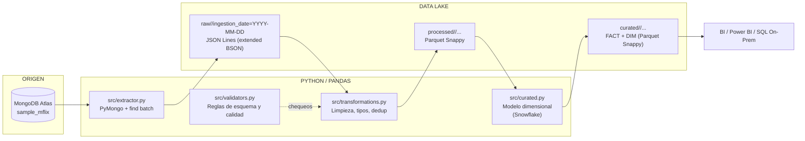
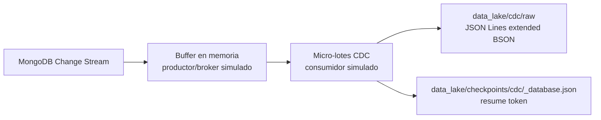
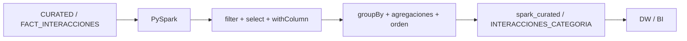

# ETL MongoDB Atlas -> Data Lake -> Parquet Snappy para BI

Pipeline ETL incremental y reproducible que extrae datos de MongoDB Atlas
(`sample_mflix`), los almacena en zonas RAW / PROCESSED / CURATED dentro de un
Data Lake local y los deja listos para consumo por herramientas de BI / data
warehouse mediante archivos **Parquet con compresion Snappy**.

## Arquitectura



## Streaming CDC (MongoDB Change Streams)

El ETL batch anterior permanece sin cambios. Como extensión independiente, el
proyecto incluye un consumidor CDC que simula el recorrido de **Kafka + Spark
Streaming** sin instalar esas plataformas aún:



Ejecute el consumidor en una segunda terminal, mientras ocurren inserciones,
actualizaciones o eliminaciones en MongoDB:

```powershell
python streaming.py --duration 60 --microbatch-size 100
python streaming.py --collections comments,movies  # continuo, detener con Ctrl+C
```

MongoDB Atlas debe ser un clúster con replica set (Atlas lo proporciona), pues
Change Streams no funciona en una instancia MongoDB aislada. Cada micro-lote
se escribe antes de confirmar su `resume token`; por eso ofrece entrega
*at-least-once*: ante una caída puede repetirse un evento, pero no se confirma
uno que no haya sido almacenado. Los eventos CDC se guardan separados de
`raw/` para no mezclarlos con los documentos completos que alimentan el ETL
batch ni cambiar su lógica.

## Spark Job — Fase 2

El job PySpark consume la fotografía más reciente de
`curated/FACT_INTERACCIONES/`, por lo que no recalcula ni altera el ETL. Genera
la tabla analítica `INTERACCIONES_CATEGORIA` en `spark_curated/`, lista para cargar
en un Data Warehouse o consultar desde BI.



```powershell
pip install -r requirements.txt
python spark_jobs.py --master "local[*]"
python spark_jobs.py --root C:\data\lake --single-file
```

Las transformaciones son distribuidas: filtrado de hechos,
selección de columnas, normalización de nulos y tipos, agrupación por
`categoria`, conteo de interacciones, rating/longitud promedio y orden por actividad. En Windows,
`--single-file` convierte el resultado agregado a Pandas y genera un único
Parquet Snappy, evitando la dependencia local de Hadoop `winutils.exe`; úsalo
solo para demostraciones o resultados pequeños. Sin esa opción se conserva la
escritura distribuida estándar de Spark, adecuada para un clúster Hadoop. Se
requiere Java compatible con la versión de PySpark instalada.

Nota: PROCESSED se construye **releyendo RAW** (la capa RAW es la única fuente
de verdad de la corrida), no a partir de la memoria del proceso. Los duplicados
rechazados no se destruyen: se persisten en `data_lake/rejected/`.

Orquestador: `main.py`. Registro: `logs/datalake.log` + `data_lake/audit/run_<run_id>.json`.

## Estructura del proyecto

```
BD_Parcial/
├── main.py                     # Orquestador del pipeline
├── conexion.py                 # Wrapper legacy -> src.mongo_client
├── spark_jobs.py               # CLI del job PySpark (Fase 2)
├── spark_jobs_databricks.py    # Job adaptado a Databricks Serverless
├── iac_setup.py                # Bootstrap reproducible del entorno
├── MIGRACION_DATABRICKS.md      # Guia de migracion a Databricks
├── INSTRUCCIONES_DATABRICKS_SENCILLAS.md  # Paso a paso sin Git
├── EXPLICACION_SIMPLE_DATABRICKS.md       # Resumen para el informe
├── Catalogo_Datos_MovieLensDB_20260930.xlsx  # Catalogo de datos (evidencia)
├── requirements.txt
├── .env.example                # Plantilla de configuracion (sin secretos)
├── .gitignore
├── src/
│   ├── config.py               # Settings, carga .env (MONGODB_URI/MONGO_URI)
│   ├── logger.py               # Logging consola + archivo rotativo
│   ├── mongo_client.py         # Conexion MongoDB (retries + ping)
│   ├── extractor.py            # Extraccion colecciones -> DataFrames
│   ├── data_lake.py            # Zonas, rutas, escritura/lectura RAW
│   ├── transformations.py      # Transformadores por coleccion
│   ├── parquet_writer.py       # Escritura Parquet snappy + verificacion
│   ├── validators.py           # Reglas de negocio y calidad
│   ├── curated.py              # Modelo dimensional FACT/DIM
│   ├── streaming.py            # CDC / micro lotes (checkpoint)
│   ├── spark_jobs.py           # Lectura de ultima fotografia Parquet
│   └── data_warehouse.py       # Agregaciones a componentes analiticos
├── scripts/
│   ├── automatizacion.py       # Automatizacion de entorno y ETL
│   ├── dashboard_monitoreo.py  # Dashboard de monitoreo
│   ├── benchmarking_consultas.py
│   ├── crear_estructura.py
│   ├── generar_catalogo.py   # Catalogo automatizado + clasificacion OLTP/OLAP
│   ├── generar_datos_masivos.py
│   └── transformar_oltp_a_olap.py
├── infra/terraform/
│   ├── main.tf                 # Proyecto, cluster, red y usuarios Atlas (IaC)
│   ├── variables.tf            # Tier, region, roles (credenciales via TF_VAR)
│   ├── outputs.tf              # Cadenas de conexion para el .env
│   ├── terraform.tfvars.example
│   └── README.md               # Guia completa de uso y sustentacion
├── tests/
│   ├── conftest.py             # Fixtures (sin conexion real)
│   └── test_*.py               # 85 pruebas automaticas
└── data_lake/                  # Generado por la ejecucion (gitignored)
    ├── raw/                    # Originales (JSON Lines extended BSON)
    ├── processed/              # Limpios y tipados (Parquet Snappy)
    ├── curated/                # Modelo dimensional listo para BI
    └── rejected/               # Duplicados rechazados (trazabilidad)
```

## Instalacion y configuracion

```powershell
# 1. Entorno virtual
python -m venv .venv
.venv\Scripts\Activate.ps1

# 2. Dependencias
pip install -r requirements.txt

# 3. Configuracion .env
Copy-Item .env.example .env
#   - MONGODB_URI (opcional; si no, se usa MONGO_URI legado)
#   - MONGODB_DATABASE=sample_mflix
```

## Ejecucion

```powershell
python main.py                          # pipeline completo (todas las colecciones)
python main.py --collections movies comments   # solo subset
python main.py --root C:\data\lake             # zona raiz del Data Lake
python main.py --env .env                      # ruta del archivo .env
```

Cada ejecucion usa un `run_id` unico (`YYYYMMDD_HHMMSS`) y particion por fecha
de ingreso, por lo que **nunca sobrescribe corridas anteriores**.

## Automatizacion e infraestructura

**Decision de diseno**: para este proyecto (pipeline local + cluster Atlas ya
creado) se recomienda **automatizacion en Python** (`scripts/automatizacion.py`);
Terraform es una alternativa para gestionar SOLO el aprovisionamiento del
cluster en la nube y no ejecuta el ETL ni administra el Data Lake local.

- **Script Python (elegido)**: prepara y verifica el entorno, prueba la
  conexion con `sample_mflix`, valida sus colecciones, crea zonas del Data Lake
  y ejecuta el pipeline de principio a fin. Mismo lenguaje que el proyecto, sin
  credenciales de nube adicionales y reproducible en un entorno academico.
- **Terraform (`infra/terraform/`)**: provee los recursos del cluster MongoDB
  Atlas como Infraestructura-asi-Codigo alineado con el Capitulo 4.1 del
  documento del curso (proyecto, cluster AWS `us-east-1`, IP Access List y
  usuarios `readWriteAnyDatabase`/`read`). Tier configurable: **M0 gratis**
  (default) o **M10** estandar del curso (~$57 USD/mes). Admite importar el
  cluster existente en vez de crear uno nuevo. Credenciales via `TF_VAR_*`,
  nunca en el repositorio (ver `infra/terraform/README.md`).

Modos del script:

```powershell
python scripts\automatizacion.py --check       # diagnostico: deps, .env, zonas, Atlas
python scripts\automatizacion.py --setup       # crea .env (plantilla) y zonas del Data Lake
python scripts\automatizacion.py --pipeline    # ejecuta el ETL completo (main.py)
python scripts\automatizacion.py --all         # check + setup + pipeline
python scripts\automatizacion.py --all --with-tests   # incluye pytest
python scripts\automatizacion.py --full        # cadena: estructura, OLAP, ETL, DW,
                                               # benchmark, Spark, dashboard (+ auditoria)
```

El modo `--check` conecta a `sample_mflix`, lista las colecciones existentes y
valida que las configuradas existan; ante cualquier problema indica el paso a
resolver sin exponer credenciales (la URI se muestra enmascarada).

El modo `--full` ejecuta la cadena de sustentacion en orden (con parada ante
el primer fallo y auditoria en `data_lake/audit/automatizacion_<ts>.json`):
estructura + indices, OLAP `interacciones_analiticas`, ETL, DW estrella,
benchmark de 10 consultas, Spark `INTERACCIONES_CATEGORIA` y dashboard PNG.
El CDC/streaming queda fuera por ser continuo: se corre aparte en una segunda
terminal (`python streaming.py --collections comments,movies --duration 60`).

## Ejecucion local de la corrida 2026-10-14 (`run_20261014_190228`)

| Zona        | Dataset            | Registros | Bytes    | Compresion |
|-------------|--------------------|-----------|----------|------------|
| RAW (jsonl) | users              | 185       | 32 915   | -          |
| RAW (jsonl) | movies             | 21 349    | 35 550 795 | -        |
| RAW (jsonl) | comments           | 41 079    | 14 771 434 | -        |
| RAW (jsonl) | theaters           | 1 564     | 383 370  | -          |
| PROCESSED   | users              | 185       | 12 185   | snappy     |
| PROCESSED   | movies             | 21 349    | 16 268 981 | snappy   |
| PROCESSED   | comments           | 41 079    | 3 853 918 | snappy    |
| PROCESSED   | theaters           | 1 564     | 199 538  | snappy     |
| CURATED     | FACT_INTERACCIONES | 41 079    | 632 196  | snappy     |
| CURATED     | DIM_TIEMPO         | 41 080    | 302 961  | snappy     |
| CURATED     | DIM_PELICULA       | 21 349    | 739 824  | snappy     |
| CURATED     | DIM_USUARIO        | 236       | 12 294   | snappy     |

Tiempo total de la corrida: ~37.5 s (extraccion por red; la latencia varia
entre ejecuciones). Cada `run_id` es una fotografia completa e inmutable:
las ejecuciones repetidas coexisten sin sobrescribirse ni generar duplicados.

## Modelo dimensional (CURATED)

Actividad de streaming sobre `sample_mflix` (coherente con
`interacciones_analiticas` del script `transformar_oltp_a_olap.py`). Aqui nada
se vende: las medidas son de actividad, no de dinero.

- **FACT_INTERACCIONES** (1 fila por comentario):
  `interaccion_id`, `dim_tiempo_key`, `dim_usuario_key`, `dim_pelicula_key`,
  `categoria=genres[0]`, `cantidad=1`, `rating_pelicula=imdb.rating`,
  `longitud_comentario`.
- **DIM_PELICULA**: `movie_id`, `titulo`, `categoria=genres[0]`,
  `marca=directors[0]`, `anio_estreno`, `duracion_min`, `clasificacion=rated`.
- **DIM_USUARIO**: `usuario_sk`, `segmento=Registrado|Anonimo`, `nombre`, `email`; un
  comentario se asocia al usuario **Registrado** si `comments.name` coincide
  exactamente con `users.name`, en caso contrario queda como **Anonimo**
  (`anon:<nombre>`).
- **DIM_TIEMPO**: granularidad diaria desde la fecha del comentario; fila
  `DESCONOCIDO` para fechas nulas/invalidas.

## Zonas y decisiones de diseno

- **RAW**: JSON Lines con `bson.json_util` (extended JSON), conserva `_id` y
  tipos BSON; sidecar `<run>.meta.json` con conteos; se conserva la informacion
  original completa (datos crudos para re-procesado).
- **PROCESSED**: se construye **releyendo RAW** (no desde memoria); Parquet
  Snappy por coleccion, tipos normalizados, dedup por `_id`, fechas con `NaT`
  ante valores invalidos (no se descartan filas), `password` de usuarios
  eliminado (minimizacion de datos) y diccionarios residuales serializados a
  JSON para compatibilidad con el esquema Parquet.
- **CURATED**: modelo dimensional listo para BI; las claves del FACT son los
  ids "naturales" (fecha, `movie_id`, `usuario_sk`), no secuenciales.
- **REJECTED**: los duplicados rechazados no se destruyen; se persisten por
  corrida en `rejected/<coleccion>/ingestion_date=.../` (JSON Lines) y el
  balance `extraidos = procesados + rechazados` se valida en cada etapa.
- **CDC RAW**: eventos `insert`, `update`, `replace` y `delete` de Change
  Streams; se persisten por micro-lote en una zona independiente y conservan
  el token, clave del documento, documento completo cuando MongoDB lo entrega
  y la descripcion de la actualizacion. El checkpoint es global a la base
  porque el stream se abre con `db.watch`.
- **Inmutabilidad**: ninguna escritura sobrescribe; cada `run_id` es una
  fotografia completa del origen.
- **Verificacion**: al escribir cada Parquet se relee el archivo y se compara el
  conteo de columnas y filas; si el conteo no cuadra se elimina el archivo y se
  aborta con `ParquetWriteError`.

## Por que Parquet

- **Columnares**: solo se leen las columnas necesarias de una consulta, no filas
  enteras; acelera agregaciones y reduce I/O en BI.
- **Comprimido por defecto**: suele ocupar menos espacio que CSV/JSON sin perder
  legibilidad posterior.
- **Esquema tipado y autodescrito**: preserva tipos (int, float, date, listas) y
  permite validar el esquema al leerlo; a diferencia del CSV no hay reinferencia
  de tipos en cada carga.
- **Proyeccion y predicado (pushdown)**: los motores de consulta descartan
  columnas y particiones innecesarias antes de materializar datos.
- **Estandar abierto**: soportado por Pandas/PyArrow, Spark, DuckDB, Polars y las
  herramientas de BI (Power Query / ODBC) sin perdida de fidelidad.
- Es el formato de intercambio natural entre un Data Lake y un DW/BI moderno.

## Por que Snappy

- **Compresion con alta velocidad**: el trade-off de Snappy favorece velocidad de
  compresion/descompresion sobre el ratio; decodifica mas rapido que gzip, lo
  que mejora las consultas frecuentes a costa de archivos un poco mas grandes.
- **Baile de bytes**: es el codec por defecto soportado por PyArrow y la
  mayoria de motores (Spark, Hive, Impala), lo que garantiza lectura cruzada.
- **Frame-splittable**: los bloques Snappy se pueden procesar en paralelo
  (printf de longitud), clave para esparcir sobre clusters.
- En el volumen del proyecto (decenas de MB) la diferencia frente a gzip es
  irrelevante; se prioriza la compatibilidad y la velocidad de lectura.

## Quality Gates

```powershell
python -m pytest -q      # 85 pruebas (sin conexion real, mocks)
```

## Limitaciones y mejoras a escala

- El volumen actual (~65 K documentos) cabe en memoria; a mayor escala se debe
  usar extraccion/transformacion por streaming (procesamiento por lotes
  encadenados) o motores distribuidos (Spark/Polars sobre poligonos).
- El matching de usuarios por nombre exacto es una aproximacion; a escala real
  el modelo debe usar `user_id` de `comments` si el origen lo provee.
- La particion por `ingestion_date` es correcta para batch diario; para micro
  lotes se recomienda particionar por `run_id` o hora.
- El BI puede leer Parquet directamente (Power Query / ODBC) o materializar a
  SQL Server para consultas SQL clasicas.
